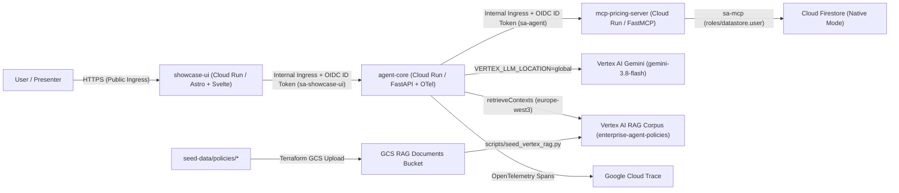

# GCP Enterprise Agent Platform

An end-to-end **Enterprise RFP Compliance & Pricing Agent Platform** built on Google Cloud Platform (GCP). It evaluates Request for Proposal (RFP) documents against corporate governance policies using **Vertex AI RAG Engine**, **Vertex AI Gemini**, **FastMCP** tools backed by **Cloud Firestore**, a split-screen **Astro + Svelte** UI, and **OpenTelemetry** tracing exported to **Google Cloud Trace**.

The infrastructure follows a strict **two-layer FinOps Terraform design**:

- **Layer 0 (`infra/layer0-bootstrap`)** provisions permanent, near-zero-cost foundation resources once per project (GCP APIs, Terraform remote state bucket, Artifact Registry, keyless GitHub Actions OIDC/WIF, a `$0` VPC for Direct VPC Egress, and monthly Billing Budget Alerts).
- **Layer 1 (`infra/layer1-platform`)** provisions the full AI runtime stack (Cloud Run services, Least-Privilege IAM, Cloud Firestore, GCS RAG bucket + auto-seeded Vertex AI RAG Corpus) on demand with **1-click `UP` / `DOWN`** via GitHub Actions—leaving zero idle compute or storage charges when torn down.

---

## Architecture



### Key Highlights

- **Keyless CI/CD & Least-Privilege Security:** GitHub Actions authenticates exclusively via **Workload Identity Federation (OIDC)** without static JSON keys. Each Cloud Run service runs under a dedicated service account (`sa-showcase-ui`, `sa-agent`, `sa-mcp`), while `agent-core` and `mcp-pricing-server` use `INGRESS_TRAFFIC_INTERNAL_ONLY` over Cloud Run Direct VPC Egress and OIDC identity tokens.
- **Automated RAG Knowledge Seeding:** Running Layer 1 `UP` uploads all policy files in `seed-data/policies/` to GCS, creates the Vertex AI RAG Corpus, grants the Vertex RAG service agent (`gcp-sa-vertex-rag`) bucket read access, and imports/indexes all documents automatically via [`scripts/seed_vertex_rag.py`](scripts/seed_vertex_rag.py).
- **Live Observability ("Under the Hood"):** `agent-core` emits structured NDJSON events (`rag_retrieval`, `policy_risk_check`, `mcp_tool_call`, `llm_generation`) to the UI in real time and flushes unified parent/child OpenTelemetry spans (`agent.analyze_rfp` -> child spans) to Cloud Trace.
- **FinOps Protection:** Permanent monthly budget alerts (`25%`, `50%`, `100%` -> `5 €`, `10 €`, `20 €` by default) and automated post-`DOWN` verification checking that `0` Cloud Run services and `0` Vertex AI RAG corpora remain.

---

## Repository Structure

```text
.
├── .github/workflows/
│   ├── build-images.yml          # Unit tests, Astro build, Docker Buildx, Trivy scan & push to Artifact Registry
│   └── lifecycle-switch.yml      # Manual 1-click Layer 1 UP (apply + seed + health check) & DOWN (destroy + verify)
├── infra/
│   ├── layer0-bootstrap/         # Permanent GCP foundation: APIs, GCS tfstate bucket, Artifact Registry, WIF, VPC, Budget Alert
│   └── layer1-platform/          # Ephemeral AI platform (modular Terraform: iam, storage, vertex_rag, cloud_run)
├── scripts/
│   └── seed_vertex_rag.py        # Idempotent Vertex AI RAG Corpus create/seed/status/destroy CLI
├── seed-data/
│   ├── policies/                 # Enterprise governance Markdown/PDF/TXT policies indexed into Vertex AI RAG
│   └── sample-rfps/              # Sample RFP documents (1x GREEN/feasible, 1x RED/compliance blocker)
└── services/
    ├── agent-core/               # FastAPI + Vertex AI Gemini + Vertex RAG client + OIDC MCP client + OpenTelemetry
    ├── mcp-pricing-server/       # FastMCP + FastAPI tool server (get_role_rates, submit_compliance_report + Firestore)
    └── showcase-ui/              # Astro 5 + Svelte 5 split-screen demo app + server-side OIDC streaming proxy
```

---

## Prerequisites

### 1. Google Cloud & IAM Permissions

You need a Google Cloud account with an active **Cloud Billing Account** and permissions to create or configure a project:

- Project-level permissions to bootstrap Layer 0 (for example `roles/owner`, or equivalent IAM, Service Usage, Storage, Artifact Registry, Compute, and Resourcemanager Admin permissions).
- Billing-account permissions (`roles/billing.admin` **Billing Account Administrator** or `roles/billing.costsManager`) on the linked billing account so Terraform can create the monthly FinOps Budget Alert.

### 2. Local CLI Tools

Install the following tools locally for the initial one-time Layer 0 bootstrap (and optional local development):

| Tool | Recommended Version | Purpose |
| --- | --- | --- |
| [Google Cloud SDK (`gcloud`)](https://cloud.google.com/sdk/docs/install) | Latest | Create/link GCP project, authenticate ADC, inspect live resources |
| [Terraform](https://developer.hashicorp.com/terraform/install) | `>= 1.5.0` (CI uses `1.17.2`) | Apply `infra/layer0-bootstrap` (and optionally run Layer 1 locally) |
| [GitHub CLI (`gh`)](https://cli.github.com/) | Latest | Optional helper to set Actions Variables and trigger workflows |
| Python | `3.13` | Needed only for local testing / running [`scripts/seed_vertex_rag.py`](scripts/seed_vertex_rag.py) |
| Node.js | `22+` | Needed only for local frontend development (`services/showcase-ui`) |

---

## From-Scratch Setup Guide

Follow these steps once to stand up the platform in your own GCP project and GitHub repository.

### Step 1: Fork & Clone the Repository

Fork this repository on GitHub (so GitHub Actions runs under your repository and authenticates via OIDC), then clone your fork locally:

```bash
git clone https://github.com/<YOUR_GITHUB_OWNER>/<YOUR_GITHUB_REPO>.git
cd <YOUR_GITHUB_REPO>
```

---

### Step 2: Create a GCP Project, Link Billing & Authenticate

Set shell variables for your setup (replace placeholders with your values) and create a fresh project:

```bash
export PROJECT_ID="<YOUR_PROJECT_ID>"      # e.g. gcp-agent-platform-dev (must be globally unique)
export REGION="europe-west3"               # Default region (Vertex AI RAG + Cloud Run + Firestore)

gcloud auth login
gcloud projects create "$PROJECT_ID" --name="GCP Enterprise Agent Platform"
gcloud config set project "$PROJECT_ID"
```

Find your Billing Account ID, link it to the new project, and confirm the billing currency:

```bash
gcloud billing accounts list
export BILLING_ACCOUNT_ID="<YOUR_BILLING_ACCOUNT_ID>"   # e.g. 01A44C-EB29CE-4771C9

gcloud billing projects link "$PROJECT_ID" --billing-account="$BILLING_ACCOUNT_ID"
gcloud billing projects describe "$PROJECT_ID" --format=yaml
gcloud billing accounts describe "$BILLING_ACCOUNT_ID" --format=yaml
```

> [!IMPORTANT]
> Make sure the project is actually linked to `$BILLING_ACCOUNT_ID` before applying Layer 0. Google's Billing Budgets API returns `400 INVALID_ARGUMENT` if `budget_filter.projects` references a project not linked to that billing account, or if `currency_code` does not match the billing account's currency.

Finally, configure Application Default Credentials (ADC) so Terraform can provision resources locally:

```bash
gcloud auth application-default login
gcloud auth application-default set-quota-project "$PROJECT_ID"
```

---

### Step 3: Configure Project-Specific Settings

Because Terraform `backend "gcs"` blocks cannot contain variables, update the remote state bucket name in [`infra/layer1-platform/versions.tf`](infra/layer1-platform/versions.tf) so it matches the bucket Layer 0 will create (`${project_id}-tfstate-layer1` by default):

```hcl
# infra/layer1-platform/versions.tf
terraform {
  required_version = ">= 1.5.0"

  backend "gcs" {
    bucket = "<YOUR_PROJECT_ID>-tfstate-layer1"
    prefix = "layer1-platform"
  }
  ...
}
```

If your GCP Billing Account uses a currency other than `EUR` (for example `USD`), update `currency_code` in [`infra/layer0-bootstrap/main.tf`](infra/layer0-bootstrap/main.tf) inside `google_billing_budget.project_budget` (`specified_amount.currency_code`) to match `gcloud billing accounts describe`.

Commit and push any changes made in [`infra/layer1-platform/versions.tf`](infra/layer1-platform/versions.tf) (and `main.tf` if currency changed) so GitHub Actions sees them on `main`:

```bash
git add infra/layer1-platform/versions.tf
git commit -m "chore: configure project state bucket for Layer 1"
git push origin main
```

Next, create an untracked `infra/layer0-bootstrap/terraform.tfvars` file (already ignored by `.gitignore`) for your local Layer 0 bootstrap:

```hcl
# infra/layer0-bootstrap/terraform.tfvars
project_id         = "<YOUR_PROJECT_ID>"
region             = "europe-west3"
github_owner       = "<YOUR_GITHUB_OWNER>"
github_repo        = "<YOUR_GITHUB_REPO>"
billing_account_id = "<YOUR_BILLING_ACCOUNT_ID>"
monthly_budget_eur = 20
```

> [!NOTE]
> The WIF provider condition in Layer 0 restricts OIDC logins strictly to `assertion.repository == "${var.github_owner}/${var.github_repo}"`. Double-check capitalization/spelling of `github_owner` and `github_repo`.

---

### Step 4: Apply Layer 0 — Permanent Bootstrap (One-Time)

Initialize and apply Layer 0 from your local terminal:

```bash
terraform -chdir=infra/layer0-bootstrap init
terraform -chdir=infra/layer0-bootstrap plan
terraform -chdir=infra/layer0-bootstrap apply
```

This creates the permanent foundation:

- **Enabled APIs** (`disable_on_destroy = false`): `aiplatform`, `run`, `artifactregistry`, `iam`, `iamcredentials`, `sts`, `cloudresourcemanager`, `firestore`, `cloudtrace`, `compute`, `billingbudgets`.
- **GCS Remote State Bucket:** `<YOUR_PROJECT_ID>-tfstate-layer1` (versioned, uniform bucket-level access, public access enforced off).
- **Artifact Registry:** Docker repo `europe-west3-docker.pkg.dev/<YOUR_PROJECT_ID>/agent-platform`.
- **Keyless GitHub WIF:** Workload Identity Pool `github-actions-pool`, OIDC Provider `github-oidc`, and Service Account `github-actions-deployer@<YOUR_PROJECT_ID>.iam.gserviceaccount.com`.
- **Permanent `$0` VPC Network:** `agent-platform-vpc` + subnet `agent-platform-subnet` (`10.10.0.0/24`, Private Google Access enabled) used for Cloud Run Direct VPC Egress to internal services.
- **FinOps Budget Alert:** Monthly budget (`20 EUR` by default) scoped to the project with thresholds at `25%`, `50%`, and `100%` (`5 €`, `10 €`, `20 €`).

Inspect the generated outputs (you will use them in the next step):

```bash
terraform -chdir=infra/layer0-bootstrap output
```

---

### Step 5: Configure GitHub Actions Repository Variables

The workflows require **no Secrets (zero JSON service account keys)**. Set the following 5 **Repository Variables** in GitHub (**Settings -> Secrets and variables -> Actions -> Variables**):

| GitHub Variable | Corresponding Layer 0 Terraform Output |
| --- | --- |
| `GCP_PROJECT_ID` | `project_id` |
| `GCP_REGION` | `region` |
| `GCP_ARTIFACT_REGISTRY` | `artifact_registry_repository_url` |
| `GCP_WIF_PROVIDER` | `workload_identity_provider` |
| `GCP_SERVICE_ACCOUNT` | `github_actions_service_account_email` |

If you have the GitHub CLI authenticated (`gh auth login`), you can set all 5 directly from Terraform outputs:

```bash
gh variable set GCP_PROJECT_ID --body "$(terraform -chdir=infra/layer0-bootstrap output -raw project_id)"
gh variable set GCP_REGION --body "$(terraform -chdir=infra/layer0-bootstrap output -raw region)"
gh variable set GCP_ARTIFACT_REGISTRY --body "$(terraform -chdir=infra/layer0-bootstrap output -raw artifact_registry_repository_url)"
gh variable set GCP_WIF_PROVIDER --body "$(terraform -chdir=infra/layer0-bootstrap output -raw workload_identity_provider)"
gh variable set GCP_SERVICE_ACCOUNT --body "$(terraform -chdir=infra/layer0-bootstrap output -raw github_actions_service_account_email)"
```

---

### Step 6: Build, Scan & Push Container Images (`build-images.yml`)

Before bringing Layer 1 `UP` for the first time, you must build and push the 3 Docker images (`mcp-pricing-server`, `agent-core`, `showcase-ui`) into Artifact Registry.

- **GitHub UI:** Open **Actions -> Build, Scan & Push Service Images -> Run workflow (`main`)**.
- **GitHub CLI:**
  ```bash
  gh workflow run build-images.yml
  gh run watch
  ```

The workflow runs Python unit tests (`pytest`) and the Astro production build (`npm run build`), builds `linux/amd64` non-root multi-stage images, scans them with Trivy, and pushes both `<git-sha>` and `latest` tags to the configured `GCP_ARTIFACT_REGISTRY` repository. It also triggers automatically whenever files under `services/**` change on `main`.

---

### Step 7: Provision Layer 1 (`UP`) & Auto-Seed Vertex AI RAG

Trigger the **Layer 1 Lifecycle Switch** to deploy the full platform and seed policies in one click:

- **GitHub UI:** Open **Actions -> Layer 1 Lifecycle Switch (UP / DOWN) -> Run workflow**
  - `action`: `UP`
  - `image_tag`: `latest`
- **GitHub CLI:**
  ```bash
  gh workflow run lifecycle-switch.yml -f action=UP -f image_tag=latest
  gh run watch
  ```

What happens automatically during `UP`:

1. Provisions Least-Privilege IAM (`sa-agent`, `sa-mcp`, `sa-showcase-ui`).
2. Creates the ephemeral GCS RAG bucket (`<YOUR_PROJECT_ID>-rag-documents`, `force_destroy = true`), uploads all files in [`seed-data/policies/`](seed-data/policies/), and creates the Firestore Native `(default)` database (`deletion_policy = "DELETE"`).
3. Provisions Vertex AI RAG Engine config (`basic`), creates corpus `enterprise-agent-policies` (`text-embedding-005`), grants `roles/storage.objectViewer` to the lazily-provisioned `gcp-sa-vertex-rag` service agent, and imports/indexes all policy files via [`scripts/seed_vertex_rag.py`](scripts/seed_vertex_rag.py).
4. Deploys all 3 Cloud Run v2 services (`mcp-pricing-server` internal, `agent-core` internal, `showcase-ui` public).
5. Polls `${SHOWCASE_UI_URL}/api/health` and writes the live **Showcase UI URL**, internal service URLs, and direct **Cloud Trace Dashboard link** into the GitHub Actions **Run Summary**.

<details>
<summary>Optional: Run Layer 1 UP manually from your local machine (instead of GitHub Actions)</summary>

```bash
python3 -m pip install google-auth
terraform -chdir=infra/layer1-platform init -input=false
terraform -chdir=infra/layer1-platform apply -auto-approve \
  -var="project_id=<YOUR_PROJECT_ID>" \
  -var="region=europe-west3" \
  -var="image_tag=latest"

terraform -chdir=infra/layer1-platform output
```

</details>

---

### Step 8: Run the Live Demo & Inspect Cloud Trace

1. Open the **`Showcase UI (Public)`** URL printed in the GitHub Actions Step Summary.
2. Test both built-in / sample RFP workflows:
   - **Grün / Machbar (`01-rfp-gruen-machbar.md`):** Cloud-native GCP architecture (`europe-west3`), Apache-2.0/MIT licensing, 1x liability cap -> yields `GREEN` recommendation with low risk score, live Vertex AI RAG context chunks, live Vertex AI Gemini synthesis, and persisted Firestore report ID.
   - **Rot / Blocker (`02-rfp-rot-blocker.md`):** Air-gapped on-prem constraint, AGPL-3.0 copyleft requirement, unlimited liability + shared root access -> yields `RED` blocker recommendation (`CLOUD_FIRST_AIRGAP`, `OSS_VIRAL_LICENSE`, `UNLIMITED_LIABILITY`).
3. Inspect the **"Under the Hood"** panel on the right for live agent step timing, Vertex AI RAG sources, MCP request/response payloads, token counts, estimated cost, and the OpenTelemetry `trace_id`.
4. Open the **Cloud Trace Dashboard** link from the workflow Summary (`https://console.cloud.google.com/traces/list?project=<YOUR_PROJECT_ID>`) and filter by the displayed `trace_id` to inspect the full waterfall (`agent.analyze_rfp` -> `agent.rag_retrieval`, `agent.policy_risk_check`, `agent.mcp_tool_call`, `agent.llm_generation`).

---

### Step 9: Tear Down Layer 1 (`DOWN`) — Zero Idle Costs

When your demo or testing session finishes, tear down Layer 1 cleanly:

- **GitHub UI:** **Actions -> Layer 1 Lifecycle Switch (UP / DOWN) -> Run workflow** with `action: DOWN`.
- **GitHub CLI:**
  ```bash
  gh workflow run lifecycle-switch.yml -f action=DOWN
  gh run watch
  ```

The workflow runs `terraform destroy -auto-approve` (which also invokes `scripts/seed_vertex_rag.py --action destroy` to force-delete the Vertex AI RAG corpus) and then asserts via `gcloud` and the Vertex AI REST API that **0 Cloud Run services** and **0 Vertex AI RAG corpora** remain in `europe-west3`. Layer 0 (state bucket, Artifact Registry images, WIF, VPC, and FinOps Budget Alert) remains preserved so you can bring Layer 1 back `UP` in a few minutes anytime.

---

## Local Development & Testing

### 1. Set Up Local Dependencies

```bash
python3.13 -m venv .venv
.venv/bin/python -m pip install --upgrade pip
.venv/bin/pip install -r services/mcp-pricing-server/requirements.txt -r services/agent-core/requirements.txt
npm --prefix services/showcase-ui ci
```

### 2. Run Unit Tests & Frontend Build

```bash
PYTHONPATH=services/mcp-pricing-server .venv/bin/pytest services/mcp-pricing-server/tests -v
PYTHONPATH=services/agent-core .venv/bin/pytest services/agent-core/tests -v
ASTRO_TELEMETRY_DISABLED=1 npm --prefix services/showcase-ui run build
```

### 3. Run All 3 Services Locally

Start each service in its own terminal. By default, setting `FIRESTORE_ENABLED=false` and `VERTEX_LLM_ENABLED=false` enables offline/mock execution with local policy fallback and in-memory compliance reports:

**Terminal 1 — MCP Pricing Server (`http://localhost:8081`):**

```bash
PYTHONPATH=services/mcp-pricing-server \
FIRESTORE_ENABLED=false \
.venv/bin/uvicorn app.server:app --app-dir services/mcp-pricing-server --host 0.0.0.0 --port 8081 --reload
```

**Terminal 2 — Agent Core (`http://localhost:8082`):**

```bash
PYTHONPATH=services/agent-core \
MCP_PRICING_SERVER_URL=http://localhost:8081 \
VERTEX_LLM_ENABLED=false \
.venv/bin/uvicorn app.main:app --app-dir services/agent-core --host 0.0.0.0 --port 8082 --reload
```

> To test against **live GCP Vertex AI Gemini & Cloud Trace** locally (after `gcloud auth application-default login` and Layer 1 `UP` if using live Vertex RAG):
>
> ```bash
> PYTHONPATH=services/agent-core \
> GCP_PROJECT_ID="<YOUR_PROJECT_ID>" \
> GCP_REGION="europe-west3" \
> VERTEX_LLM_ENABLED=true \
> VERTEX_LLM_LOCATION=global \
> VERTEX_RAG_CORPUS_DISPLAY_NAME=enterprise-agent-policies \
> ENABLE_CLOUD_TRACE=true \
> MCP_PRICING_SERVER_URL=http://localhost:8081 \
> .venv/bin/uvicorn app.main:app --app-dir services/agent-core --host 0.0.0.0 --port 8082 --reload
> ```

**Terminal 3 — Showcase UI (`http://localhost:8080`):**

```bash
AGENT_CORE_URL=http://localhost:8082 \
ASTRO_TELEMETRY_DISABLED=1 \
npm --prefix services/showcase-ui run dev
```

Open `http://localhost:8080` in your browser.

### 4. Standalone Vertex AI RAG Seeding CLI

[`scripts/seed_vertex_rag.py`](scripts/seed_vertex_rag.py) supports `--dry-run`, `seed`, `status`, and `destroy`:

```bash
# Preview REST payloads without calling GCP
.venv/bin/python scripts/seed_vertex_rag.py \
  --action seed \
  --project-id "<YOUR_PROJECT_ID>" \
  --region europe-west3 \
  --gcs-bucket "<YOUR_PROJECT_ID>-rag-documents" \
  --dry-run

# Inspect indexed files inside the live corpus
.venv/bin/python scripts/seed_vertex_rag.py \
  --action status \
  --project-id "<YOUR_PROJECT_ID>" \
  --region europe-west3
```

---

## Customization & Security Options

- **Custom Enterprise Policies:** Add or edit `.md`, `.pdf`, or `.txt` files under [`seed-data/policies/`](seed-data/policies/). Terraform tracks file hashes automatically and re-uploads/re-indexes them on `UP`.
- **Custom Sample RFPs:** Add `.md` files under [`seed-data/sample-rfps/`](seed-data/sample-rfps/). When running locally from the repo checkout (or when `STAGE_SAMPLE_RFPS_DIR` is set), `/api/sample-rfps` loads files from disk automatically before falling back to built-in samples in containers.
- **Lock Down Public Access on `showcase-ui`:** By default, `showcase_ui_public = true` exposes `showcase-ui` publicly for live demos (while `agent-core` and `mcp-pricing-server` remain strictly internal). Set `showcase_ui_public = false` in [`infra/layer1-platform/variables.tf`](infra/layer1-platform/variables.tf) (or pass `-var="showcase_ui_public=false"`) to require Cloud Run IAM authentication and connect via `gcloud run services proxy showcase-ui --region=europe-west3`. *(Note: `ui_basic_auth_user` / `ui_basic_auth_password` only inject environment variables into the Cloud Run container and are not enforced in the Astro app code; use `showcase_ui_public = false` or Cloud IAP when access control is required.)*

---

## Troubleshooting & Operational Notes

- **Firestore `(default)` Recreation Cooldown (~5 minutes):** After running `lifecycle-switch` `DOWN` (which deletes the ephemeral `(default)` Firestore database), GCP enforces roughly a 5-minute cooldown before allowing a `(default)` Firestore database to be recreated with the same ID. Wait ~5 minutes between `DOWN` and the next `UP`.
- **Gemini `VERTEX_LLM_LOCATION=global` vs Regional RAG (`europe-west3`):** Active Gemini 3.x models (`gemini-3.8-flash`, `gemini-3.1-pro-preview`, `gemini-3.5-flash-lite`) are invoked on `VERTEX_LLM_LOCATION=global` (note: [`services/agent-core/app/agent.py`](services/agent-core/app/agent.py) also automatically maps legacy `gemini-2.5-*` model names to `3.x`), while Vertex AI RAG Engine, Cloud Run, GCS, and Firestore stay pinned to `europe-west3` for EU data residency.
- **Docker Container Build & Auth Verification:** Remember to run `build-images.yml` before `UP` whenever modifying files under [`services/`](services/). Layer 0 grants `github-actions-deployer` only project-level deployment roles; billing budgets are managed during one-time local Layer 0 bootstrap.
- **Full Project Decommission (Destroy Layer 0):** Ensure Layer 1 is already `DOWN` (`terraform -chdir=infra/layer1-platform destroy`), then remove Layer 0 permanently:
  ```bash
  terraform -chdir=infra/layer0-bootstrap destroy
  ```
  *(Note: Enabled GCP service APIs intentionally use `disable_on_destroy = false` so destroying Terraform state never breaks other workloads in the project.)*
